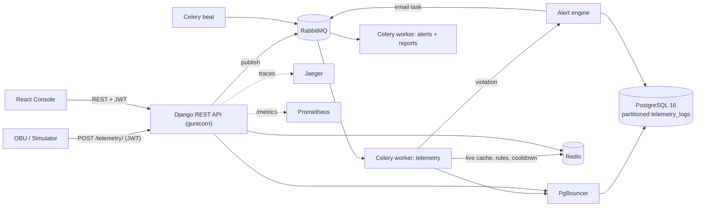
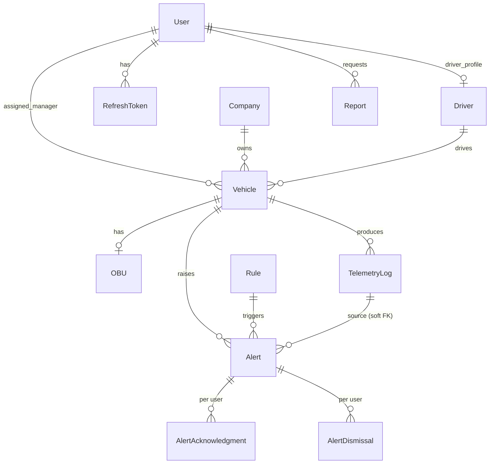

# Fleet Monitoring System

A real-time fleet monitoring platform. An on-board unit (**OBU**) in each vehicle sends telemetry, the backend checks it against **threshold rules**, raises **alerts**, and a **bilingual (Persian / English) web console** presents everything to administrators, fleet managers and drivers.

The project is built for the Iranian market: Iranian license-plate, mobile, phone and driver-license validation, Persian/Arabic digit normalization, Jalali/Gregorian vehicle years, and a full RTL interface are all built in.

This is the single, authoritative document for the whole repository (backend, frontend and OBU simulator).

---

## Table of Contents

1. [Overview and Architecture](#1-overview-and-architecture)
2. [Repository Layout](#2-repository-layout)
3. [Tech Stack](#3-tech-stack)
4. [Roles and Permissions](#4-roles-and-permissions)
5. [Quick Start](#5-quick-start)
6. [Backend (Django)](#6-backend-django)
7. [Frontend (React)](#7-frontend-react)
8. [OBU Simulator](#8-obu-simulator)
9. [API Reference](#9-api-reference)
10. [Data Model](#10-data-model)
11. [Security](#11-security)
12. [Observability and Operations](#12-observability-and-operations)
13. [Testing](#13-testing)
14. [Pre-Deployment Checklist](#14-pre-deployment-checklist)
15. [Troubleshooting](#15-troubleshooting)

---

## 1. Overview and Architecture



### Life of a telemetry packet

1. The OBU sends a JSON packet to `POST /api/v1/telemetry/` every few seconds.
2. The API validates it: max 2048 bytes, per-metric ranges, timestamp not more than 300 s in the future nor older than the retention period, OBU serial matching the vehicle's registered OBU, vehicle not `decommissioned`, and role-based access to that vehicle.
3. The packet is published to the `telemetry.raw.process` queue in RabbitMQ and the API answers `202 Accepted` **as soon as RabbitMQ confirms** the message (if the queue is unavailable: `503` with `Retry-After`).
4. The telemetry worker stores it with `INSERT ... ON CONFLICT (vehicle_id, timestamp) DO NOTHING` into the partitioned table, so retries and duplicates are harmless (idempotent).
5. The vehicle's live state in Redis is updated (only if the packet is newer than the cached one).
6. Active rules (served from a Redis cache) are evaluated against the packet.
7. For each violation, unless the vehicle+rule pair is inside its **cooldown window** (default 300 s), an `Alert` is created and an email task is queued on `alerts.trigger.notify`.
8. The email goes to the vehicle's fleet manager and all active admins.
9. Any message that still fails after its retries is moved to the `tasks.dead_letter` queue.

---

## 2. Repository Layout

```
fleet_monitoring_backend/
├── README.md                  <- this file
├── backend/                   <- Django + DRF + Celery
│   ├── fleet_monitoring/      <- core: settings, urls, validators, logging, tracing, celery, ...
│   ├── auth_module/           <- users, JWT, roles, admin user management
│   ├── vehicles_module/       <- company, drivers, vehicles, OBUs, dashboard stats
│   ├── telemetry_module/      <- telemetry ingestion and storage, partitions, retention
│   ├── rules_module/          <- threshold rules and the evaluation engine
│   ├── alerts_module/         <- alerts, per-user acknowledge/dismiss, email notification
│   ├── reports_module/        <- fleet summary reports (sync/async) and CSV export
│   ├── Dockerfile · docker-compose.yml · docker-compose.override.yml
│   └── gunicorn.conf.py · pytest.ini · requirements.txt · .env.example
├── frontend/                  <- React 19 + Vite + TypeScript
│   ├── src/{app,api,types,constants,features,components,i18n,utils,styles}
│   └── Dockerfile · docker-compose.yml · .env.example
└── OBU/                       <- OBU fleet simulator
    ├── obu_fleet_simulator.py
    └── Dockerfile · docker-compose.yml · .env.example
```

Every backend module follows the same pattern: `models.py` -> `serializers.py` -> `services.py` (business logic) -> `views.py` (thin HTTP layer) -> `urls.py`, plus `tasks.py` (Celery), `admin.py`, `tests.py` and `migrations/`.

---

## 3. Tech Stack

| Layer | Technology |
|---|---|
| Backend language / framework | Python 3.12, Django >= 5.0, Django REST Framework 3.18 |
| Database | PostgreSQL 16 behind **PgBouncer** (transaction pooling); telemetry table **partitioned by month** |
| Cache | Redis 7 (`django-redis`, with `IGNORE_EXCEPTIONS` so a cache outage never breaks the API) |
| Messaging | RabbitMQ 3.13, Celery 5.4 (two workers + beat), Dead Letter Queue |
| Authentication | JWT (PyJWT, HS256) with refresh-token rotation, bcrypt |
| API docs | drf-spectacular (Swagger UI) |
| Observability | JSON logs with Correlation-ID, Prometheus (django-prometheus + Celery exporter), OpenTelemetry -> Jaeger, Flower |
| Serving | gunicorn + WhiteNoise |
| Frontend | React 19, Vite 6, TypeScript (strict), Tailwind CSS, Radix UI (shadcn/ui style), React Router 7, TanStack Query 5, Axios, React Hook Form + Zod, Recharts, Framer Motion, date-fns |
| OBU simulator | Pure Python 3.12 (standard library only) |

---

## 4. Roles and Permissions

There are three roles (`auth_module.models.User.Role`):

| Role | Value | Description |
|---|---|---|
| System administrator | `admin` | Full access: users, rules, company, deleting vehicles/drivers |
| Fleet manager | `fleet_manager` | Only vehicles assigned to them (and related drivers, alerts, reports) |
| Driver | `driver` | Only their own vehicle, telemetry and alerts |

> Any user with `is_superuser` is automatically given the `admin` role. Public self-registration only creates `driver` accounts and can be disabled with `ALLOW_SELF_REGISTRATION=False`.

### Permission matrix

| Capability | Admin | Fleet Manager | Driver |
|---|:-:|:-:|:-:|
| Manage users (create/edit/delete/change role) | Yes | No | No |
| Edit company information | Yes | No | No |
| List / create vehicles | All | Own vehicles only (a vehicle they create is auto-assigned to them) | No (uses `/vehicles/me/`) |
| Edit a vehicle | All fields | All fields **except** `assigned_manager` | No |
| Delete a vehicle | Yes (with its OBU, telemetry and alerts) | No | No |
| Driver profiles (create/edit) | All | Drivers of their own vehicles + drivers not yet on any vehicle | No |
| Delete a driver profile | Yes | No | No |
| Alert rules (CRUD) | Yes | No | No |
| View telemetry | All | Own vehicles | Own vehicle only (`/telemetry/me/`) |
| Send telemetry (`POST /telemetry/`) | All | Own vehicles | Own vehicle |
| Alerts (view / acknowledge / dismiss from own list) | All | Own vehicles (from assignment time) | Own vehicle (from assignment time) |
| Reports | Own + system-generated | Own only | No |
| Dashboard stats | Fleet-wide | Own fleet only | No (separate driver dashboard) |

---

## 5. Quick Start

### Prerequisites
Docker and Docker Compose for the full stack. For running without Docker: Python 3.12, Node.js 20, PostgreSQL, Redis and RabbitMQ.

### Step 1 - Backend

```bash
cd backend
cp .env.example .env
# Change SECRET_KEY, JWT_SIGNING_KEY, DB_PASSWORD, RABBITMQ_PASSWORD and FLOWER_PASSWORD

docker compose up --build
```

`docker compose up` automatically also applies `docker-compose.override.yml` (development mode: ports bound to `127.0.0.1`, `runserver` instead of gunicorn, source mounted as a volume). For production, use the main file only:

```bash
docker compose -f docker-compose.yml up -d --build
```

The `migrate` service runs migrations before `web` and the workers start (this also creates the telemetry partitions and seeds the `Default Company` record).

Create the first admin:

```bash
docker compose exec web python manage.py createsuperuser
```

| URL | Purpose |
|---|---|
| http://localhost:8000/api/docs/ | Swagger UI (when `ENABLE_API_DOCS=True`) |
| http://localhost:8000/health/ | Service health (database + cache) |
| http://localhost:8000/admin/ | Django admin (path configurable via `ADMIN_URL`) |
| http://localhost:15672 | RabbitMQ Management |
| http://localhost:5555 | Flower (login with `FLOWER_USER` / `FLOWER_PASSWORD`) |
| http://localhost:16686 | Jaeger UI |
| http://localhost:9808 | Celery Prometheus exporter |

### Step 2 - Frontend

```bash
cd frontend
cp .env.example .env
docker compose up --build        # or: npm install && npm run dev
```

The console is served at http://localhost:5173.

### Step 3 - Sample data and the OBU simulator

1. Log in to the console as the admin, create a **user with the driver role** and a **driver profile** for them.
2. Create a **vehicle** with status `active`, give it an **OBU serial** (e.g. `OBU-2026-0001`) and assign the driver.
3. Start the simulator:

```bash
cd OBU
cp .env.example .env     # set ADMIN_USERNAME / ADMIN_PASSWORD to match your admin
docker compose up --build
```

Within a few seconds live data appears on the dashboard and vehicle page. Create a **rule** (for example `speed > 100`) to start producing alerts.

### Running the backend without Docker

```bash
cd backend
python -m venv .venv && source .venv/bin/activate
pip install -r requirements.txt
# In .env: DB_HOST=localhost, DB_PORT=5432, and local Redis/RabbitMQ URLs
python manage.py migrate
python manage.py runserver

# In separate terminals:
celery -A fleet_monitoring worker -n telemetry@%h -Q telemetry.raw.process
celery -A fleet_monitoring worker -n default@%h  -Q alerts.trigger.notify,reports.generate
celery -A fleet_monitoring beat
```

For a quick trial without RabbitMQ you can set `CELERY_TASK_ALWAYS_EAGER=True`, which runs tasks immediately in-process.

---

## 6. Backend (Django)

### 6.1 Modules

**`fleet_monitoring` (core)**
`settings.py` (env-driven with validation; with `DEBUG=False` weak or default secrets are rejected at startup), `validators.py` (Iranian validators), `persian.py` (digit/letter normalization, national code), `exceptions.py` (unified error handler), `middleware.py` (Correlation-ID), `logging_utils.py` (JSON logging), `tracing.py` / `otel.py` (OpenTelemetry), `celery.py`, `dead_letter.py`, `metrics.py` (allowed metric ranges), `pagination.py` (opt-in pagination), `views.py` (`/health/` and `/metrics`).

**`auth_module`**
Registration, login, refresh with **token rotation** and reuse detection, logout (refresh-token revocation), profile, password change (revokes all sessions), and admin user management. Safeguards: an admin cannot demote/deactivate/delete themselves; the last active admin cannot be removed; username and email are unique case-insensitively. Changing a role or deactivating a user has side effects (for example a driver's profile and vehicle assignments are cleared).

**`vehicles_module`**
- `Company`: **single-tenant** - exactly one company record for the whole system.
- `Driver`: driver profile linked to a user with the `driver` role (unique 10-digit license number, optional unique mobile number).
- `Vehicle`: public `vehicle_id`, Iranian plate, VIN, make/model/year (Jalali or Gregorian), status (`active` / `maintenance` / `inactive` / `decommissioned`), driver, fleet manager.
- `OBU`: one-to-one with the vehicle, serial format `OBU-YYYY-NNNN`.
- The times a manager and a driver were assigned (`manager_assigned_at`, `driver_assigned_at`) are recorded automatically and drive alert visibility.
- Dashboard stats, live vehicle status and the ingest lookup use short-lived caches.

**`telemetry_module`**
Asynchronous packet ingestion, **immutable** storage (no update/delete) in `telemetry_logs`, monthly partitions, retention cleanup, and the live-state cache.

**`rules_module`**
A rule has `metric` in {`speed`, `engine_temperature`, `battery_voltage`, `fuel_level`, `odometer`}, `operator` in {`gt`, `gte`, `lt`, `lte`, `eq`}, a `threshold` (within the metric's physical range), `severity` in {`low`, `medium`, `high`, `critical`}, and `is_active`. The (metric, operator, threshold) combination is unique. Active rules are cached in Redis (300 s) and the cache is invalidated on every change. `eq` uses `math.isclose`.

Allowed metric ranges:

| Metric | Min | Max |
|---|---:|---:|
| speed (km/h) | 0 | 500 |
| engine_temperature (°C) | -60 | 300 |
| battery_voltage (V) | 0 | 50 |
| fuel_level (%) | 0 | 100 |
| odometer (km) | 0 | 10,000,000 |

**`alerts_module`**
- An alert is a **snapshot** (rule name, metric, threshold, value, severity) and survives deletion of its rule.
- **Acknowledge** and **dismiss (remove from my list)** are fully **per-user**: acknowledging or deleting an alert in one role's view never affects the other roles.
- **Visibility rule:** admins see everything. A fleet manager sees only alerts on vehicles currently assigned to them that were created **at or after** their assignment time. A driver sees the same for their own vehicle. When a driver or manager changes, the new person does not see alerts from before they were assigned, and the previous person loses access.
- Alert lists are capped at 500 items.

**`reports_module`**
- **Synchronous:** `GET /reports/fleet-summary/` computes and returns immediately.
- **Asynchronous:** `POST /reports/generate/` returns `202`; poll `GET /reports/{id}/` until `completed` or `failed`.
- A daily system report (06:00 UTC) is generated and visible only to admins.
- Window is capped at 366 days, default 30 days.
- Summary contents: vehicle count and status breakdown, number of readings, average speed and fuel, distance traveled (odometer delta), alert counts by severity, acknowledged/unacknowledged, and average acknowledgment time.
- Each user sees a gap-free `sequence_number` for their own reports.
- CSV export (`section,key,value`) for completed reports.

### 6.2 Celery tasks

| Queue | Tasks |
|---|---|
| `telemetry.raw.process` | `process_telemetry_packet`, `cleanup_old_telemetry`, `ensure_future_telemetry_partitions`, `system_health_check`, `cleanup_expired_refresh_tokens` |
| `alerts.trigger.notify` | `dispatch_alert_notification` |
| `reports.generate` | `generate_report_task`, `generate_scheduled_fleet_report` |
| `tasks.dead_letter` | Dead Letter Queue for failed messages |

Beat schedule (all UTC):

| When | Task |
|---|---|
| Every 5 minutes | `system_health_check` |
| 01:00 | Create telemetry partitions for the next 3 months |
| 02:00 | Delete telemetry older than the retention period |
| 03:30 | Clean up expired refresh tokens |
| 06:00 | Daily system-wide fleet summary report |

Reliability policy: `acks_late`, `reject_on_worker_lost`, prefetch 1 (20 for the telemetry worker), exponential backoff with jitter for transient errors, and dead-lettering when retries are exhausted or on non-retryable errors.

### 6.3 Telemetry retention

`telemetry_logs` is partitioned monthly (`telemetry_logs_YYYY_MM`). The nightly cleanup `DROP`s fully expired partitions (fast, no bloat) and deletes any remaining old rows in batches; alert references to removed logs are set to `NULL`. A warning is logged if rows land in the `default` partition. Default retention: 365 days.

### 6.4 Backend environment variables (`backend/.env`)

| Variable | Example default | Description |
|---|---|---|
| `SECRET_KEY` | - | Required in production (>= 32 chars, not a placeholder) |
| `DEBUG` | `True` | `False` in production |
| `ALLOWED_HOSTS` | `localhost,127.0.0.1` | Allowed hosts |
| `CORS_ALLOWED_ORIGINS` | localhost:3000/5173 URLs | Frontend origins |
| `ENABLE_HTTPS_ENFORCEMENT` | `False` | HTTPS redirect, HSTS, secure cookies (`True` in production) |
| `ADMIN_URL` | `admin/` | Path of the Django admin |
| `ENABLE_API_DOCS` | `True` | Enables `/api/docs/` and `/api/schema/` |
| `METRICS_TOKEN` | empty | Bearer token for `/metrics` (empty and not DEBUG => 404) |
| `NUM_PROXIES` | `0` | Number of proxies, for client-IP detection |
| `LOG_LEVEL` | `INFO` | Log level |
| `JWT_SIGNING_KEY` | - | JWT signing key (>= 32 chars; keep separate from `SECRET_KEY`) |
| `JWT_ACCESS_LIFETIME_MINUTES` | `30` | Access token lifetime |
| `JWT_REFRESH_LIFETIME_DAYS` | `7` | Refresh token lifetime |
| `AUTH_MAX_FAILED_LOGINS` | `5` | Failed logins before lockout |
| `AUTH_LOCKOUT_SECONDS` | `900` | Lockout duration (per username + IP) |
| `ALLOW_SELF_REGISTRATION` | `True` | Public registration (driver role) |
| `DB_NAME` / `DB_USER` / `DB_PASSWORD` | `fleet_db` / `fleet_user` / - | Database credentials |
| `DB_HOST` / `DB_PORT` | `pgbouncer` / `6432` | For local runs: `localhost` / `5432` |
| `REDIS_URL` | `redis://localhost:6379/1` | Cache |
| `RABBITMQ_USER` / `RABBITMQ_PASSWORD` / `RABBITMQ_VHOST` / `RABBITMQ_URL` | - | Celery broker |
| `CELERY_RESULT_BACKEND_URL` | `redis://localhost:6379/2` | Result backend |
| `CELERY_TASK_ALWAYS_EAGER` | `False` | Run tasks synchronously (testing/dev) |
| `CELERY_CONCURRENCY` | `4` | Default worker concurrency |
| `TELEMETRY_RETENTION_DAYS` | `365` | Telemetry retention |
| `TELEMETRY_MAX_FUTURE_SECONDS` | `300` | Max allowed timestamp skew into the future |
| `TELEMETRY_CACHE_TTL_SECONDS` | `86400` | Live-state cache lifetime |
| `ALERT_COOLDOWN_SECONDS` | `300` | Minimum gap between alerts for the same vehicle+rule pair |
| `FLOWER_USER` / `FLOWER_PASSWORD` | - | Flower login |
| `GUNICORN_WORKERS` / `GUNICORN_TIMEOUT` | `4` / `30` | gunicorn settings |
| `OTEL_*`, `TRACE_SPAN_LOGGING`, `SERVICE_VERSION`, `DEPLOYMENT_ENVIRONMENT` | - | OpenTelemetry settings |

Optional variables read by `settings.py` that are not in `.env.example`: `EMAIL_BACKEND`, `EMAIL_HOST`, `EMAIL_PORT`, `EMAIL_HOST_USER`, `EMAIL_HOST_PASSWORD`, `EMAIL_USE_TLS`, `DEFAULT_FROM_EMAIL`, `DB_CONN_MAX_AGE`, `DB_CONNECT_TIMEOUT`, `REDIS_MAX_CONNECTIONS`, `REDIS_MAXMEMORY`, `CELERY_TELEMETRY_CONCURRENCY`, `CELERY_TELEMETRY_PREFETCH`, `CELERY_TASK_TIME_LIMIT`, `GUNICORN_THREADS`, `FORWARDED_ALLOW_IPS`.

> **Email:** by default the email backend is the console backend, so alert emails are only printed to the log. For real delivery set `EMAIL_BACKEND=django.core.mail.backends.smtp.EmailBackend` and the SMTP settings.

### 6.5 Iranian validators

| Field | Format | Example |
|---|---|---|
| License plate | 2 digits + 1 Persian letter + 3 digits + 2 digits (city code) | `12ب34567` |
| Mobile | `09` + 9 digits | `09123456789` |
| Landline (company) | `0` + 10 digits | `02112345678` |
| Driver license | 10 digits | `1234567890` |
| VIN | 17 characters, no I/O/Q | `1HGCM82633A004352` |
| OBU serial | `OBU-YYYY-NNNN` | `OBU-2026-0001` |
| `vehicle_id` | letters/digits and `. _ -`, up to 50 chars | `veh_8a3f2b1c` |
| Vehicle year | Jalali 1330-1420 or Gregorian 1950 to next year | `1402` / `2023` |

Persian/Arabic digits and the letters `ي ى ك` are normalized automatically. Equivalent validators exist in the frontend (`src/utils/iranValidators.ts`).

---

## 7. Frontend (React)

A bilingual operations console: **Persian (RTL) / English (LTR)** with light and dark themes.

### 7.1 Running and configuration

| Command | Purpose |
|---|---|
| `npm run dev` | Dev server on port 5173 |
| `npm run build` | `tsc -b` + production build |
| `npm run preview` | Preview the build |
| `npm run lint` / `npm run typecheck` / `npm run format` | Code quality (ESLint, TypeScript, Prettier; Husky + lint-staged) |

| Variable | Default | Description |
|---|---|---|
| `VITE_API_BASE_URL` | `http://localhost:8000/api/v1` | API base URL (no trailing slash) |
| `VITE_POLL_INTERVAL_MS` | `15000` | Polling interval for "live" data |

### 7.2 Pages by role

| Route | Role | Page |
|---|---|---|
| `/login`, `/register` | Public | Sign in and register |
| `/` | All | Dashboard (drivers get a dedicated driver dashboard) |
| `/profile` | All | Profile and password change |
| `/vehicles`, `/vehicles/new`, `/vehicles/:id`, `/vehicles/:id/edit` | Admin, Manager | Vehicle list, create, detail, edit |
| `/drivers`, `/drivers/new`, `/drivers/:id/edit` | Admin, Manager | Driver management |
| `/telemetry` | Admin, Manager | Telemetry charts + manual reading dialog |
| `/alerts`, `/alerts/:id` | Admin, Manager | Alerts |
| `/reports`, `/reports/:id` | Admin, Manager | Reports and CSV export |
| `/rules`, `/rules/new`, `/rules/:id/edit` | Admin | Alert rules |
| `/admin/users`, `/admin/users/new`, `/admin/users/:id/edit` | Admin | User management |
| `/my-vehicle/:id` | Driver | My vehicle |
| `/my-alerts`, `/my-alerts/:id` | Driver | My alerts (with acknowledge and delete buttons) |
| `/403`, `*` | - | Forbidden / Not found |

Routes are guarded by `RequireAuth` (based on `allowedRoles`), and after login `resolveLoginRedirect` makes sure a user is never sent to a route their role cannot access. All pages are lazy-loaded.

### 7.3 Architecture

```
src/
├── app/          router, AppLayout, RequireAuth, providers, ErrorBoundary, Theme/Language context
├── api/          Axios instance + interceptors, tokenStorage, one service file per backend module
├── types/        TypeScript types mirroring the backend serializers
├── constants/    roles, statuses, routeAccess, queryKeys (matching backend enums)
├── features/     auth, dashboard, vehicles, drivers, telemetry, alerts, rules, reports, admin, profile, misc
├── components/   ui/ (shadcn-style primitives) and shared/ (DataTable, FilterBar, Sidebar, Navbar, StatCard, ...)
├── i18n/         translations.ts (fa/en) and apiErrors.ts (maps API errors to displayable text)
├── utils/        formatters, iranValidators, jalali, cn
└── styles/       Tailwind + design tokens
```

Design notes:
- **TanStack Query** owns all server state. Context is used only for the session (`AuthContext`) and UI state (theme, language). Query keys are centralized in `constants/queryKeys.ts`.
- **Polling** via `refetchInterval` for telemetry, alerts and vehicles; structured so it can be swapped for WebSockets later.
- **Auth:** tokens are kept in `localStorage` (`fleet.auth.*`). The Axios interceptor refreshes once on `401` (concurrent requests share one refresh) and on failure dispatches the `fleet:session-expired` event to tear down the session.
- **Bilingual:** `LanguageContext` with key `fleet.ui.language`; the default comes from the browser language; direction and Persian font are applied on `<html>`. Every translation key must exist in both languages (`TranslationKey` is derived from the English dictionary).
- **Jalali/Gregorian year:** vehicle manufacture year is converted with a fixed 621-year offset (the conventional approximation when only a year is available).
- **Forms:** React Hook Form + Zod; rule thresholds are validated against exactly the same ranges as the backend `METRIC_RANGES`.
- **API contract:** list endpoints for vehicles and drivers return a plain array unless `page` / `page_size` is passed (see [Responses and errors](#responses-and-errors)). Telemetry is capped at 500 rows, alerts at 500 and reports at 200. Vehicle status, alert severity and rule metric filters on the list pages are applied client-side.

---

## 8. OBU Simulator

`OBU/obu_fleet_simulator.py` (Python standard library only) discovers the fleet from the API and sends realistic telemetry for every eligible vehicle.

**Behavior:**
- Logs in with the admin account (and refreshes the token before it expires).
- Every `DISCOVERY_INTERVAL_SECONDS` it fetches the vehicle list; newly eligible vehicles start sending, and vehicles that become inactive, are deleted or lose their driver stop.
- A vehicle is eligible when its status is in `SEND_FOR_STATUSES`, it has an active OBU with a serial, and (if `REQUIRE_DRIVER=true`) it has a driver.
- If the vehicle already has telemetry, the simulation continues from the last position, odometer and fuel.
- Simulation: speed random-walks between 0 and 130 km/h, the vehicle moves around a per-vehicle home point (derived from a hash of its id) near Tehran, odometer increases, fuel decreases (and refills below 8%), engine temperature follows speed, and battery voltage drifts.
- **Rate limiter:** a global cap of `MAX_PACKETS_PER_MINUTE` (default 90, to stay under the backend's 100/min ingestion throttle) and an automatically increased per-vehicle interval as the fleet grows. It reacts sensibly to `429` (honoring `Retry-After`), `503` and network outages.
- Clean shutdown on `SIGINT` / `SIGTERM`.

| Variable | Default | Description |
|---|---|---|
| `API_BASE_URL` | `http://host.docker.internal:8000/api/v1` | API base URL |
| `API_HOST_HEADER` | `localhost:8000` | Host header (must be in the backend `ALLOWED_HOSTS`) |
| `ADMIN_USERNAME` / `ADMIN_PASSWORD` | `admin` / `admin` | **Change these** |
| `SEND_INTERVAL_SECONDS` | `5` | Per-vehicle send interval |
| `DISCOVERY_INTERVAL_SECONDS` | `10` | Fleet discovery interval |
| `MAX_PACKETS_PER_MINUTE` | `90` | Global rate cap |
| `SEND_FOR_STATUSES` | `active` | Comma-separated allowed statuses |
| `REQUIRE_DRIVER` | `true` | Only simulate vehicles that have a driver |
| `START_LAT` / `START_LON` | `35.6892` / `51.3890` | Simulation center (Tehran) |
| `FUEL_DROP_PER_SECOND` | `0.008` | Fuel consumption rate |

Example packet:

```json
{
  "vehicle_id": "veh_8a3f2b1c",
  "obu_serial": "OBU-2026-0001",
  "timestamp": "2026-10-03T08:15:30+00:00",
  "speed": 72.4,
  "engine_temperature": 88.1,
  "battery_voltage": 13.62,
  "fuel_level": 74.3,
  "latitude": 35.70123,
  "longitude": 51.40456,
  "odometer": 48210.5
}
```

> On Linux, `extra_hosts: host.docker.internal:host-gateway` in the compose file makes that address reachable. If the backend and the simulator share a Docker network, set `API_BASE_URL` to the service name (`http://web:8000/api/v1`) and adjust `API_HOST_HEADER` to match `ALLOWED_HOSTS`.

---

## 9. API Reference

All paths are prefixed with `/api/v1/` and (unless stated) require `Authorization: Bearer <access_token>`. Full interactive docs: `/api/docs/`.

### Authentication - `/auth/`

| Method | Path | Access | Description |
|---|---|---|---|
| POST | `/auth/register/` | Public | Register (driver role) |
| POST | `/auth/login/` | Public | Returns `{user, access_token, refresh_token}` |
| POST | `/auth/refresh/` | Public | Rotate the refresh token and get a new access token |
| POST | `/auth/logout/` | User | Revoke the supplied refresh token |
| GET / PATCH | `/auth/profile/` | User | View / edit own name and email |
| POST | `/auth/profile/change-password/` | User | Change password (revokes all sessions) |

### User management - `/admin/users/` (Admin only)

| Method | Path | Description |
|---|---|---|
| GET / POST | `/admin/users/` | List (filter `?role=`) / create a user with any role |
| GET / PATCH / DELETE | `/admin/users/{id}/` | Retrieve / update (role, active, name, email) / delete |

### Vehicles, drivers, company - `/vehicles/`

| Method | Path | Access | Description |
|---|---|---|---|
| GET / POST | `/vehicles/` | Admin, Manager | List (`status`, `search`, `driver`, `assigned_manager`, `page`, `page_size`) / create |
| GET / PATCH | `/vehicles/{id}/` | Admin, Manager | Retrieve / update |
| DELETE | `/vehicles/{id}/` | Admin | Delete with OBU, telemetry and alerts |
| GET | `/vehicles/{id}/status/` | Per role scope | Cached status + latest live telemetry |
| GET | `/vehicles/me/` | Driver | My vehicle(s) |
| GET | `/vehicles/dashboard-stats/` | Admin, Manager | Dashboard statistics |
| GET / POST | `/vehicles/drivers/` | Admin, Manager | List (`search`) / create a driver profile |
| GET | `/vehicles/drivers/linkable-users/` | Admin, Manager | Driver-role users without a profile |
| GET | `/vehicles/drivers/assignable/` | Admin, Manager | Drivers that can be assigned to a vehicle |
| GET / PATCH / DELETE | `/vehicles/drivers/{id}/` | Admin, Manager (DELETE: Admin only) | Manage a driver |
| GET / PATCH | `/vehicles/company/` | Admin | Company information |

### Telemetry - `/telemetry/`

| Method | Path | Access | Description |
|---|---|---|---|
| POST | `/telemetry/` | Any user with access to that vehicle | Ingest a packet -> `202 {status, dispatch_id}` |
| GET | `/telemetry/` | Admin, Manager | `vehicle_id`, `start`, `end`, `limit` (1-500) |
| GET | `/telemetry/me/` | Driver | Telemetry of my vehicle |

### Rules - `/rules/` (Admin only)

| Method | Path | Description |
|---|---|---|
| GET / POST | `/rules/` | List (`?is_active=`) / create |
| GET / PATCH / DELETE | `/rules/{id}/` | Retrieve / update / delete |

### Alerts - `/alerts/`

| Method | Path | Access | Description |
|---|---|---|---|
| GET | `/alerts/` | Admin, Manager | Alerts visible to me |
| GET | `/alerts/me/` | Driver | Alerts on my vehicle |
| GET | `/alerts/{id}/` | Per role scope | Detail |
| DELETE | `/alerts/{id}/` | Per role scope | Remove from **my** list (stays visible to others) |
| POST | `/alerts/{id}/acknowledge/` | Per role scope | Acknowledge for myself (idempotent) |
| POST | `/alerts/me/acknowledge/` | Driver | Acknowledge with body `{alert_id}` |

### Reports - `/reports/` (Admin, Manager)

| Method | Path | Description |
|---|---|---|
| GET | `/reports/fleet-summary/` | Synchronous summary (`start_date`, `end_date`, `vehicle_id`) |
| POST | `/reports/generate/` | Request an async report -> `202` |
| GET | `/reports/` | My reports (max 200) |
| GET / DELETE | `/reports/{id}/` | Status/result / delete |
| GET | `/reports/{id}/export/` | CSV export (only when `completed`) |

### System

| Path | Description |
|---|---|
| `/health/` | Database and cache health (`200` or `503`) |
| `/metrics` | Prometheus metrics (requires `METRICS_TOKEN`; open in DEBUG) |
| `/api/docs/`, `/api/schema/` | Swagger / OpenAPI (when `ENABLE_API_DOCS`) |

### Responses and errors

- **Opt-in pagination:** vehicle and driver lists return a plain array unless you pass `page` or `page_size`, in which case the shape is `{count, next, previous, results}` (default 50, max 200).
- `400` validation error (body: field -> message) · `401` authentication · `403` permission · `404` not found · `409` conflicting record · `422` invalid telemetry packet · `429` rate limit / login lockout · `503` queue unavailable (with `Retry-After`).
- An `X-Request-ID` header is returned on every response; you may also send your own so it can be traced through logs and traces.

### Rate limits (throttling)

| Scope | Limit |
|---|---|
| Per user (general) | 1000/min |
| Login | 30/min |
| Registration | 10/min |
| Refresh | 60/min |
| Telemetry ingestion | 100/min |

In addition, after 5 failed logins for a username from one IP, login is blocked with `429` for 15 minutes.

---

## 10. Data Model



| Table | Key points |
|---|---|
| `auth_module_user` | Role, unique email, case-insensitive uniqueness on username and email |
| `auth_module_refreshtoken` | `jti`, revocation, `replaced_by` for reuse detection |
| `companies` | Single record (seeded as `Default Company`) |
| `drivers` | One-to-one with user, unique license number |
| `vehicles` | `PROTECT` on company; `SET_NULL` on driver/manager; `manager_assigned_at`, `driver_assigned_at` |
| `obus` | One-to-one with vehicle, unique serial |
| `telemetry_logs` | Monthly partitions; unique on (vehicle, timestamp); **immutable**; `raw_payload` JSON |
| `rules` | Unique on (metric, operator, threshold) |
| `alerts` | Snapshot of values; FK to the log without a DB constraint (because of partitioning) |
| `alert_acknowledgments` / `alert_dismissals` | Unique on (alert, user) |
| `reports` | `status`, `result` (JSON), empty `requested_by` = system report |

---

## 11. Security

- **JWT:** HS256, short-lived access token (30 min) and **rotating** refresh tokens; reusing an already-rotated refresh token revokes all of that user's sessions. A password change also revokes every refresh token.
- **Passwords:** bcrypt-SHA256 plus Django validators (min 8 chars, common passwords, numeric-only, similarity to user attributes).
- **Login lockout** and separate throttles for login, registration and refresh.
- **RBAC** enforced in the view layer (permission classes) and again in the service layer (data scoping).
- **Ingest hardening:** size cap, per-metric ranges, `NaN`/`Inf` rejected, and the OBU must match the registered vehicle and serial.
- **Opaque 500 errors** (no internals leaked) when not in DEBUG; the Browsable API is DEBUG-only.
- **HTTPS settings** (`ENABLE_HTTPS_ENFORCEMENT`): SSL redirect, one-year HSTS with preload, Secure cookies. `nosniff`, `X-Frame-Options: DENY` and `Referrer-Policy: same-origin` are always on.
- **Startup validation:** with `DEBUG=False`, weak/placeholder keys or the default database password abort startup.
- `/metrics`, `/api/docs/` and the admin path can be hidden or protected.
- Known limitation: the frontend keeps tokens in `localStorage` (isolated in `tokenStorage.ts` so it can be swapped for httpOnly cookies).

---

## 12. Observability and Operations

- **Structured JSON logs** with `correlation_id`; an `audit` logger records important events (login, vehicle create/delete, alert acknowledgment, ...).
- **Prometheus:** `/metrics` (django-prometheus, including DB metrics) and `celery-prometheus-exporter` on port 9808.
- **Tracing:** OpenTelemetry for Django, psycopg2, Redis and Celery; OTLP export to Jaeger; sampling ratio via `OTEL_TRACES_SAMPLER_RATIO`.
- **Flower** for queues and tasks; **RabbitMQ Management** for inspecting the DLQ.
- **Healthchecks:** in the Dockerfile and compose for all core services; the `system_health_check` task records a heartbeat every 5 minutes.
- **Cache-outage tolerance:** a Redis outage does not cause errors; the system continues with warning logs and no caching (the alert cooldown lets alerts through in that case).
- **Caches:** vehicle status 60 s, ingest lookup 60 s, dashboard stats 30 s, active rules 300 s (all jittered and invalidated on change).

---

## 13. Testing

The backend has about **395 tests** (pytest + pytest-django) across `auth_module`, `vehicles_module`, `telemetry_module`, `rules_module`, `alerts_module`, `reports_module` and `fleet_monitoring`.

```bash
cd backend
pytest                       # everything
pytest alerts_module         # one module
```

Tests need a reachable PostgreSQL (partitioned table and raw SQL). The frontend has no automated tests yet; quality is enforced with `npm run lint` and `npm run typecheck`.

---

## 14. Pre-Deployment Checklist

- `backend/.env` contains secrets: do not commit it or ship it in an archive. Also leave out `.idea/`, `.pytest_cache/` and `celerybeat-schedule` (they are in `.gitignore`).
- In production: `DEBUG=False`, random and separate `SECRET_KEY` and `JWT_SIGNING_KEY`, `ENABLE_HTTPS_ENFORCEMENT=True`, exact `ALLOWED_HOSTS` and `CORS_ALLOWED_ORIGINS`, a `METRICS_TOKEN`, `ENABLE_API_DOCS=False` and an unguessable `ADMIN_URL`.
- Change the simulator's default `admin/admin` credentials, and in production use a dedicated account for devices.
- Behind a reverse proxy, set `NUM_PROXIES` and `FORWARDED_ALLOW_IPS` so client IPs (used for login lockout) are detected correctly.
- Configure real SMTP for alert emails (default: printed to the log).
- The backend and frontend Dockerfiles use pip/npm mirrors (`mirror-pypi.runflare.com` and `registry.npmmirror.com`); change them if you have direct access or another mirror.

---

## 15. Troubleshooting

| Problem | Cause / fix |
|---|---|
| `web` won't start and raises `ImproperlyConfigured` | With `DEBUG=False` the keys are weak/placeholders; set strong values. |
| `docker compose up` complains about an empty variable | `RABBITMQ_USER`, `RABBITMQ_PASSWORD`, `DB_PASSWORD`, `FLOWER_USER`, `FLOWER_PASSWORD` are required in `.env`. |
| Simulator gets `400 Invalid HTTP_HOST` or cannot connect | Align `API_HOST_HEADER` with `ALLOWED_HOSTS` and check `API_BASE_URL`. |
| Simulator doesn't see a vehicle | The vehicle must be `active`, have an active OBU with a valid serial and (by default) a driver. |
| Packets return `422` | OBU serial doesn't match the registered OBU, vehicle is `decommissioned`, timestamp is in the future or too old, or a value is out of range. |
| Packets return `202` but no data appears | The telemetry worker is down or the message went to the DLQ (`tasks.dead_letter`); check Flower and the RabbitMQ UI. |
| No alert is created | The rule is inactive, the condition isn't met, or the vehicle+rule pair is still in its cooldown (300 s). |
| A new manager/driver can't see old alerts | By design: alert visibility starts at assignment time (admins are unrestricted). |
| Alert emails don't arrive | The default `EMAIL_BACKEND` is the console backend; configure SMTP. |
| `429` on login | Temporary lockout after 5 failed attempts; wait 15 minutes. |
| Frontend shows `Network Error` | Check `VITE_API_BASE_URL` and the backend `CORS_ALLOWED_ORIGINS`. |
